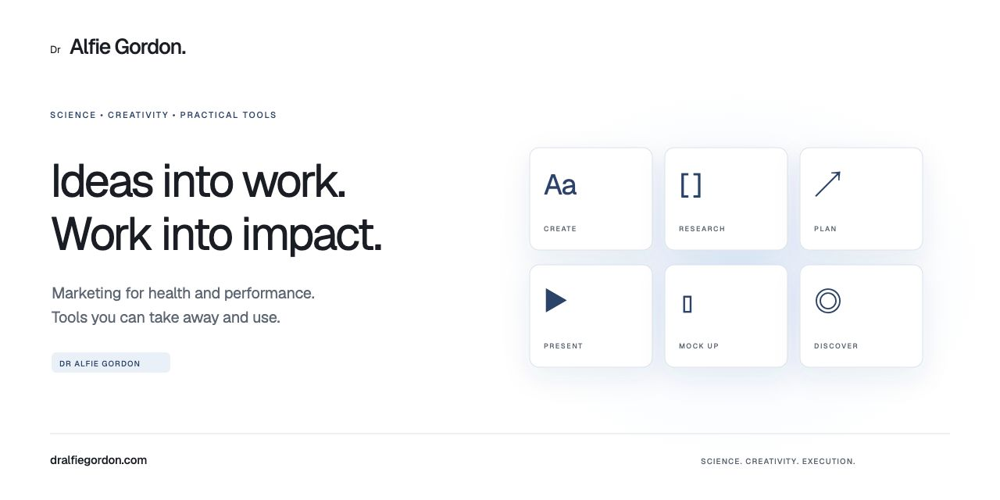
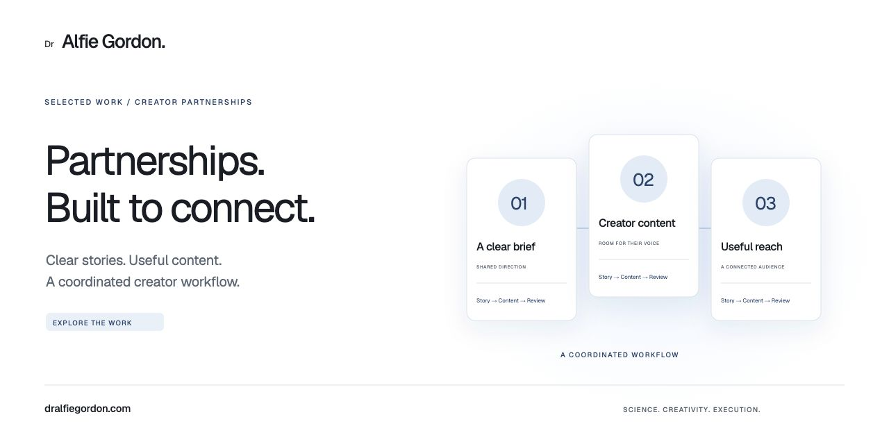
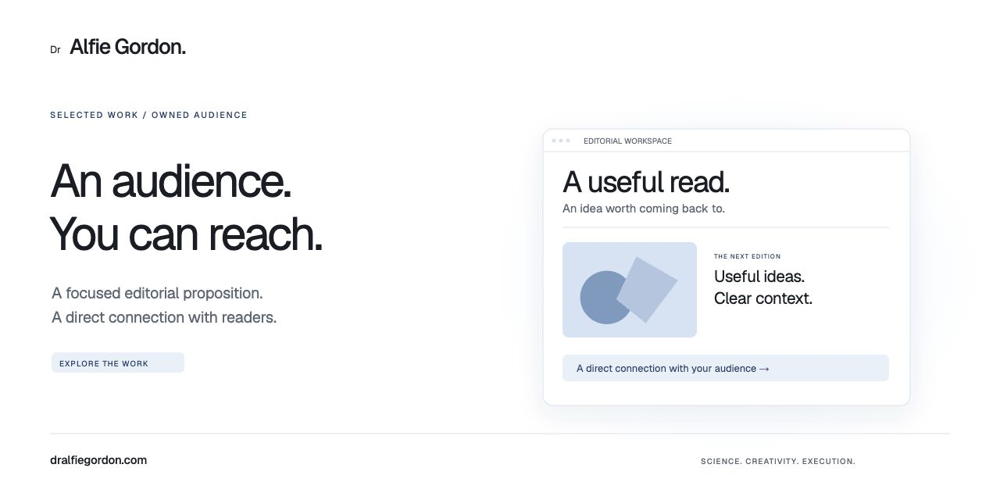
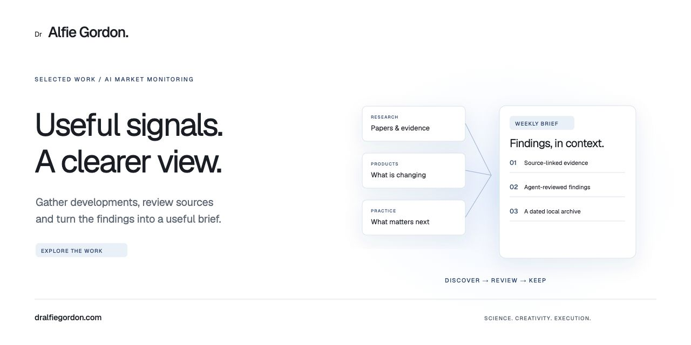
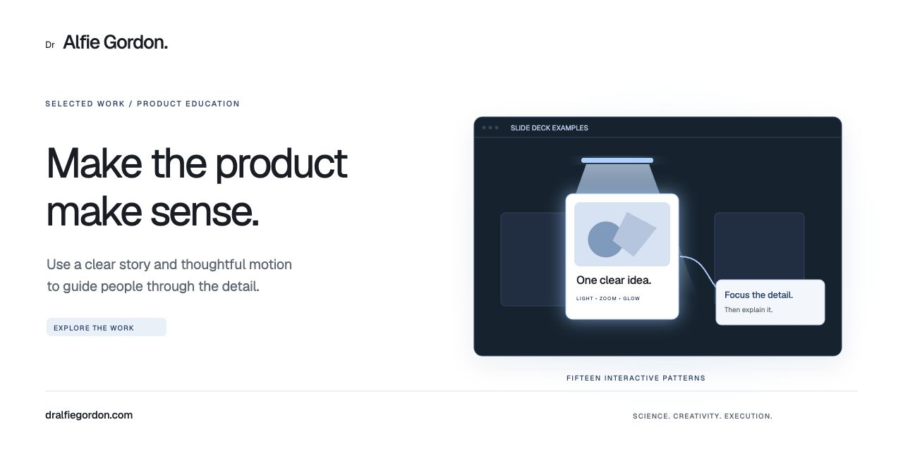

# Marketing for health and performance brands.

I’m **Alfie Gordon** — a scientist and marketer helping health and performance brands **build customer trust and drive growth**. I combine scientific understanding, creative execution and AI to make products easier to understand.

🟢 <strong>Marketing Manager at</strong> <a href="https://hexis.live"><picture><source media="(prefers-color-scheme: dark)" srcset="assets/hexis-light.svg"></picture></a> · PhD Applied Physiology · Edinburgh, UK

[Portfolio](https://dralfiegordon.com) · <a href="https://www.youtube.com/@dralfiegordon"> YouTube</a> · [Watch & learn](https://dralfiegordon.com/knowledge-base) · [Newsletter](https://dralfiegordon.com/email) · [CV](https://dralfiegordon.com/cv)

## Selected work

<table>
<tr>
<td width="50%" valign="top"><a href="https://dralfiegordon.com/knowledge-base/hexis-pat-creator-partnership"> <strong>Creator partnerships</strong></a></td>
<td width="50%" valign="top"><a href="https://dralfiegordon.com/knowledge-base/how-i-built-pninsider"> <strong>Build an owned audience</strong></a></td>
</tr>
<tr>
<td width="50%" valign="top"><a href="https://dralfiegordon.com/knowledge-base/i-built-a-performance-nutrition-research"> <strong>AI market monitoring</strong></a></td>
<td width="50%" valign="top"><a href="https://dralfiegordon.com/knowledge-base/i-built-an-animated-presentation"> <strong>Product education</strong></a></td>
</tr>
</table>

## Tools to take away

- **[Creator Asset Variants](https://github.com/dralfiegordon/creator-asset-variants)** — batch-personalise social graphics with creator names, discount codes and campaign copy.
- **[PubMed Search Builder](https://github.com/dralfiegordon/pubmed-search-builder)** — build and refine a focused literature search.
- **[Campaign Production Kit](https://github.com/dralfiegordon/campaign-production-kit)** — keep the brief, assets and launch plan in one visual workspace.
- **[Slide Deck Examples](https://github.com/dralfiegordon/slide-deck-examples)** — explore interactive presentation patterns, then build your own deck.
- **[Screenshot Mockup Studio](https://github.com/dralfiegordon/screenshot-mockup-studio)** — turn screenshots into polished product mockups.
- **[Performance Nutrition Signal Harvest](https://github.com/dralfiegordon/performance-nutrition-signal-harvest)** — discover developments, review sources and keep a dated evidence brief.

---

**Have something in mind?** I’m available for freelance projects outside my working hours at Hexis.

[Book a collaboration call](https://cal.com/alfie-gordon-z0emgt/30min)
