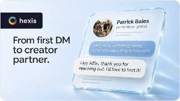
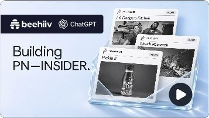
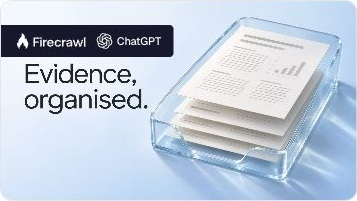
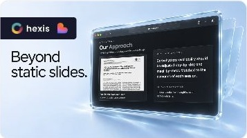

# Marketing for health and performance brands.

I’m **Alfie Gordon** — a scientist and marketer helping health and performance brands **build customer trust and drive growth**. I combine scientific understanding, creative execution and AI to make products easier to understand.

🟢 **Marketing Manager at [Hexis](https://hexis.live)** · PhD Applied Physiology · Edinburgh, UK

[Portfolio](https://dralfiegordon.com) · <a href="https://www.youtube.com/@dralfiegordon"> YouTube</a> · [Watch & learn](https://dralfiegordon.com/knowledge-base) · [Newsletter](https://dralfiegordon.com/email) · [CV](https://dralfiegordon.com/cv)

## Selected work

<table>
<tr>
<td width="25%" valign="top">
<a href="https://dralfiegordon.com/knowledge-base/hexis-pat-creator-partnership"> <strong>Creator partnerships</strong></a>
</td>
<td width="25%" valign="top">
<a href="https://dralfiegordon.com/knowledge-base/how-i-built-pninsider"> <strong>Build an owned audience</strong></a>
</td>
<td width="25%" valign="top">
<a href="https://dralfiegordon.com/knowledge-base/i-built-a-performance-nutrition-research"> <strong>AI market monitoring</strong></a>
</td>
<td width="25%" valign="top">
<a href="https://dralfiegordon.com/knowledge-base/i-built-an-animated-presentation"> <strong>Product education</strong></a>
</td>
</tr>
</table>

## Tools to take away

- **[Creator Asset Variants](https://github.com/dralfiegordon/creator-asset-variants)** — batch-personalise social graphics with creator names, discount codes and campaign copy.
- **[`/pubmed-search-builder`](https://github.com/dralfiegordon/pubmed-search-builder)** — a downloadable Claude skill for scoping and refining literature searches.

---

**Have something in mind?** I’m available for freelance projects outside my working hours at Hexis.

[Book a collaboration call](https://cal.com/alfie-gordon-z0emgt/30min)
